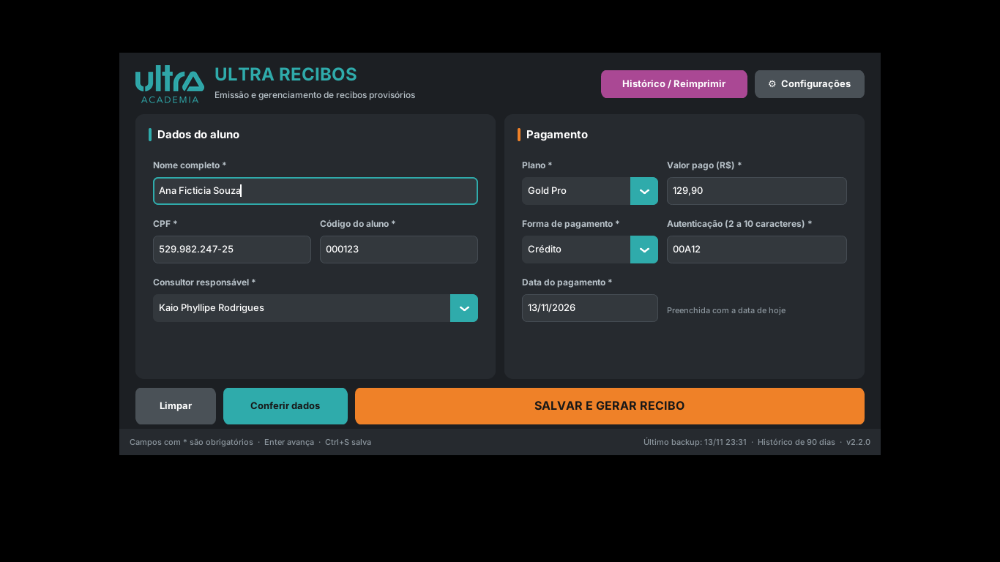
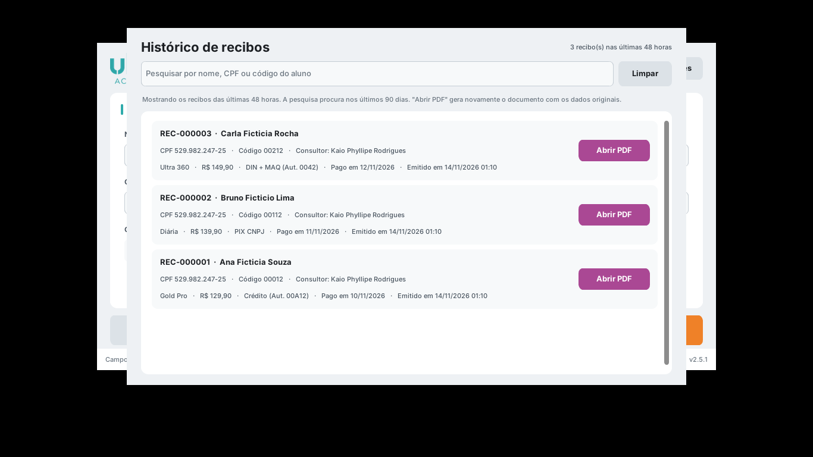
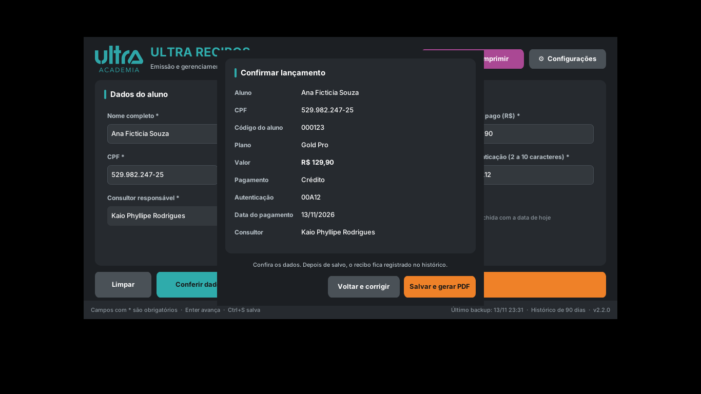

# Ultra Recibos 2.5.1

Emissão de recibos provisórios em PDF para a Ultra Academia (Windows 10/11).
Desenvolvedor: Kaio Phyllipe Rodrigues.



| Histórico e reimpressão | Conferência antes de salvar |
|---|---|
|  |  |

> As capturas usam apenas dados fictícios.

## Download

O instalador para Windows (`UltraRecibos_Setup_2.5.1.exe`) está na página
[Releases](../../releases) do repositório.

## Tecnologias

Python · CustomTkinter · ReportLab · SQLite · PyInstaller · Inno Setup

## Funcionalidades

- Formulário com validação de CPF, valor, data e código de autenticação
- Conferência dos dados antes de salvar e alerta de possível duplicidade
- Geração do recibo em PDF com dados e logotipo da empresa
- Histórico de 90 dias com pesquisa e reimpressão
- Backup diário automático e restauração
- Cadastro de consultores, planos e formas de pagamento
- Tema claro e escuro

## Uso de inteligência artificial

Projeto idealizado e desenvolvido por Kaio Phyllipe Rodrigues para uso real na
Ultra Academia. Ferramentas de inteligência artificial, principalmente o
**Claude** (Anthropic), foram usadas como apoio para evoluir e melhorar o
projeto:

- revisão do código e correção de erros;
- melhorias na interface, nas validações e na segurança dos dados;
- criação dos testes automatizados;
- documentação do código: comentários (`#`) explicando cada parte, como os
  blocos que identificam as seções do `main.py` (Aplicativo, Inicialização,
  Cabeçalho, Formulário...), para facilitar a manutenção e o entendimento de
  tudo o que foi feito;
- documentação do projeto (este README e o `CHANGELOG.md`).

As mudanças propostas foram analisadas e aprovadas por mim antes de entrarem
no programa.

## Executar pelo Python (desenvolvimento)

```bat
python -m pip install -r requirements.txt
python main.py
```

No modo Python, os dados ficam na pasta `dados\` do projeto.
No executável instalado, ficam em `%LOCALAPPDATA%\UltraRecibos`.

## Testes automatizados

```bat
python tests\executar_testes.py
```

Os testes usam uma pasta temporária (variável `ULTRARECIBOS_DADOS`) e apenas
dados fictícios. Nunca tocam no banco real.

## Gerar executável e instalador

Requer Python e (opcional) Inno Setup 6.3+.

```bat
build_windows.bat
```

1. instala as dependências; 2. executa os testes; 3. gera `dist\UltraRecibos\`
com o PyInstaller; 4. gera `instalador\UltraRecibos_Setup_2.5.1.exe`.

O `AppId` do instalador é o mesmo das versões anteriores: a instalação
atualiza a versão existente e **não apaga** banco, PDFs nem backups.

## Estrutura

| Arquivo | Função |
|---|---|
| `main.py` | Janela principal (formulário, conferência, salvamento) |
| `tela_historico.py` | Histórico de 90 dias e reimpressão |
| `tela_admin.py` | Configurações: Empresa, Consultores, Sistema |
| `dialogos.py` | Janela de resumo/confirmação do recibo |
| `tema.py` | Cores, fontes e componentes visuais |
| `validacoes.py` | CPF, CNPJ, valor, data, autenticação, máscaras |
| `database.py` | SQLite: criação/migração, gravação e consultas |
| `receipt_pdf.py` | Geração do PDF (ReportLab) |
| `backup.py` | Backup diário consistente do SQLite + configuração |
| `limpeza_pdfs.py` | Exclusão de PDFs com mais de 90 dias |
| `empresa_config.py` | Dados da empresa e logotipo |
| `consultores.py` | Cadastro de consultores |
| `opcoes.py` | Planos e formas de pagamento editáveis |
| `instancia_unica.py` | Impede duas cópias abertas (opção J) |
| `seguranca_admin.py`, `recuperacao_admin.py` | Login administrativo (não utilizado na interface atual) |
| `caminhos.py`, `configuracoes.py`, `registro.py` | Pastas, parâmetros e log |
| `tests/` | Testes automatizados |
| `dados_locais.exemplo.py` | Modelo do arquivo de dados locais (ver abaixo) |

## Dados locais (empresa e consultores)

Os dados reais da empresa e os nomes dos consultores ficam em
`dados_locais.py`, que não é enviado ao GitHub (`.gitignore`).
Sem esse arquivo, o programa usa dados de exemplo.

Para usar dados reais, copie `dados_locais.exemplo.py` para
`dados_locais.py` e preencha os valores.

## Pastas de dados

```
UltraRecibos\
  recibos.db          banco de dados
  empresa.json        dados da empresa
  logo_empresa.png    logotipo personalizado
  pdfs\               recibos gerados (apagados após 90 dias)
  backups\            backup_recibos_AAAAMMDD.db + configuracao_AAAAMMDD\
  logs\               ultrarecibos.log (erros e eventos, sem dados pessoais)
```
